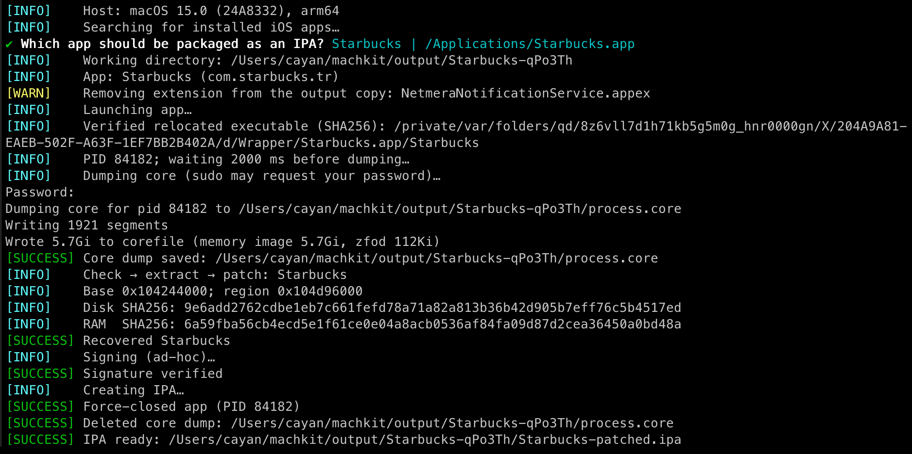

# unipa

Takes a running iOS app on an Apple Silicon Mac, pulls its decrypted code out of a core dump, and builds an IPA from it. The installed app is never modified.

> **Disclaimer:** unipa is provided "as is", without warranty. Use it at your own risk and only on apps you own or are authorized to analyze. To the extent permitted by applicable law, the authors and contributors accept no liability for damage, data loss, or other consequences of its use. You are responsible for how you use the tool and the files it produces.

## Requirements

- Apple Silicon Mac
- macOS 15.0 to 15.2 for live dumps (see [Compatibility](#compatibility))
- Bun 1.4.4+ (Node.js is not supported)
- Python 3.10+ (standard library only, no pip packages)
- `gcore`, `ditto`, `codesign`, and `unzip`

## Compatibility

iOS apps have run natively on Apple Silicon Macs since [Big Sur](https://developer.apple.com/videos/play/wwdc2020/10114/), though individual apps may need a newer macOS.

Dumping a live process is a separate matter. It relies on a privileged entitlement in the system `gcore`, which [FFRI's research](https://www.ffri.jp/wp-content/uploads/2026/01/gcore.pdf) found in macOS 15.0 and which was removed in 15.3. That points to 15.0 through 15.2 as the working window. Only 15.0 (build 24A8332) has been tested with unipa, so treat the other releases as unconfirmed.

unipa logs your macOS version but does not block any release. A successful startup does not mean the dump will work.

## Install

```bash
git clone https://github.com/cayank/unipa
cd unipa
bun install
bun link
```

After that, `unipa` works from any directory. The link points to this checkout, so do not move the folder. `bun unlink` removes it.

Check the installed version with `unipa --version`.

## Usage

Run `unipa` with no arguments to pick an iOS App Store app from `/Applications/`, or pass the path yourself:

```bash
unipa --app /Applications/Example.app
unipa --app /Applications/Example.app --pid 12345 --wait-ms 5000
```

If the app is already running, unipa uses that process. Otherwise it launches the app. `--pid` picks a specific process, and `--wait-ms` sets how long to wait before dumping. Taking a new core may ask for your `sudo` password.

<!-- <a href="docs/cli-example.jpg">
  
</a> -->

To retry patching and packaging from a core you already have, no app launch needed:

```bash
unipa --app /Applications/Example.app --core /tmp/example.core
```

### Bundle settings

Change the output bundle ID or optionally its name:

```bash
unipa --app /Applications/Example.app --bundle-id random --bundle-name "Application Test"
```

Pass an exact ID instead of `random` to use your own value. These settings apply to the IPA and, with `--macos`, the Mac copy. See [bundle settings](docs/bundle.md) for defaults and signing implications.

### Mac app (experimental)

`--macos` also produces a Mac Catalyst app that runs directly on your Mac:

```bash
unipa --app /Applications/Example.app --macos
```

```text
output/example-XXXXXX/
├── example-patched.ipa
└── macos/
    └── Example.app
```

Add `--isolated-keychain` for independent local storage, or `--keychain-instance <name>` for another persistent instance. See [Keychain storage](docs/keychain.md) for compatibility and security limits.

It needs the Xcode Command Line Tools (`xcode-select --install`) and cannot be combined with `--no-sign` or `--keep-extensions`. See [macOS conversion](docs/catalyst.md) for details and known limits.

### Dylib injection

Use `--inject` to embed a local iOS dylib into the output app. Repeat the flag for multiple libraries. Compressed `.dylib.gz` and `.dylib.xz` files are also accepted.

```bash
unipa --app /Applications/Example.app --inject ./dylibs/unipa-flex.dylib
```

Store libraries in the Git-ignored `dylibs/` directory or pass any local path. Add `--macos` to build an injected Mac copy if the library and its dependencies support conversion. See [dylib injection](docs/injection.md) for details.

## Extensions

App extensions (`PlugIns/*.appex`) are removed from the output by default and listed in `manifest.json`. Features that depend on them, such as notification handling, may not work.

To keep them, use `--keep-extensions`. An encrypted extension can run in its own process, so it may need a separate dump, which you pass with `--core-for`:

```bash
unipa \
  --app /Applications/Example.app \
  --core /tmp/example.core \
  --keep-extensions \
  --core-for 'PlugIns/NotificationService.appex/NotificationService=/tmp/notification.core'
```

To keep most extensions but drop one, add `--exclude-extension NotificationService.appex` instead. `--core-for` and `--exclude-extension` can each be repeated. If an encrypted executable is left in a kept extension, packaging stops.

## Output and signing

Each run saves the IPA, patched app, and recovery reports under `output/<app-name>-XXXXXX/` in the checkout. Folder and IPA names use lowercase and hyphens, with accents removed (`Example App` → `example-app`). Long names are shortened. Use `--work-dir` to choose another parent directory. Failed runs keep their files.

Signing is ad-hoc by default. `--identity 'Apple Development: …'` picks a different identity, and `--no-sign` skips signing (patching breaks the original signature either way). The main executable must be thin, little-endian 64-bit Mach-O. Universal bundled binaries and injected libraries are reduced to a compatible slice in the output copy. 32-bit binaries are rejected.

## Installing the IPA

The ad-hoc signature is not enough to install on an iPhone or iPad. You will need to re-sign it, for example with [Sideloadly](https://sideloadly.io/) (see its [FAQ](https://sideloadly.io/faq)). Even then, an IPA that builds fine is not guaranteed to install or run.

## Cleanup

Once everything passes verification and `manifest.json` is saved, unipa force-quits the app process it dumped and deletes the core it created. If recovery, packaging, macOS conversion, or the initial manifest write fails, both are left in place so you can investigate.

Cores you supply with `--core` or `--core-for` are never deleted. `--core` skips live dumping. With only `--core-for`, unipa may still launch and dump the app if another encrypted binary needs a core. If cleanup itself fails, the IPA is kept, the error is written to `manifest.json`, and the exit code is nonzero.

To preview or remove cores left over from failed runs, from the project directory:

```bash
bun run clean:cores --dry-run
bun run clean:cores
bun run clean:cores --work-dir /path/to/output
```

Only regular `process.core` files directly inside recognized run folders are removed. Run folders are checked against `source.json`. Symlinks and all other output are left alone.

More on how recovery works, the report files, and development commands is in [Internals](docs/internals.md).

## License

Licensed under the [MIT License](LICENSE).
